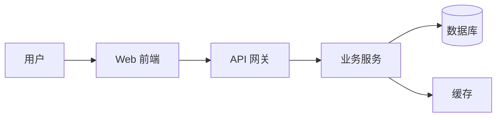
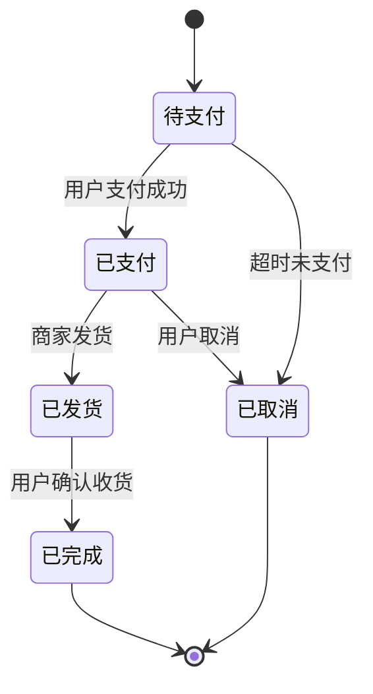

# 12 章工程方案书模板

> 来源：调研报告 §三
> 用途：阶段 3 的核心产出模板

## 使用说明

按以下 12 章顺序生成方案书。每章都有**要点**和**常见缺失**（即低质量方案书最容易漏的部分）。

---

## 模板骨架

```markdown
# {项目名} 开发方案书 / Engineering Plan

> 文档类型：{Design Doc | 6-Pager | ADR | One-Pager}（由路由器决定）
> 状态：Draft | Under Review | Approved
> 作者 / 评审人 / 更新日期

## 1. 背景与目标 【★ 必选】
- 1.1 Why Now（为什么是现在）
- 1.2 目标（可量化）
- 1.3 非目标（Non-Goals）★
- 1.4 成功指标（SLI/SLO）

## 2. 现状与约束 【△ 可选】
- 2.1 现状基线（性能/架构/技术债）
- 2.2 硬约束（时间/预算/合规/技术栈）
- 2.3 软约束（性能/可用性/可维护性预期）

## 3. 方案对比 【★ 必选（类型2/C） | △ 可选（类型1/D）】
- 3.1 候选方案 A / B / C（含"不做"选项）
- 3.2 维度对比表（成本/性能/复杂度/风险/熟悉度）
- 3.3 业界对标（Prior Art）

## 4. 推荐方案与理由
- 4.1 推荐选择
- 4.2 选择理由
- 4.3 前提条件与退路

## 5. 系统架构
- 5.1 模块/组件图（Mermaid + 渲染HTML）
- 5.2 数据流图（Mermaid + 渲染HTML）
- 5.3 关键时序图（Mermaid + 渲染HTML）
- 5.4 部署拓扑图
- ★ 5.5 业务流程图（开发者必读）
- ★ 5.6 状态机图（关键实体状态流转）

## 6. 数据模型与存储
- 6.1 核心实体与关系（ER）
- 6.2 存储选型理由
- 6.3 索引/分库/分表策略
- 6.4 数据迁移方案

## 7. API 设计
- 7.1 接口清单（OpenAPI 片段）
- 7.2 认证授权
- 7.3 版本化与错误码

## 8. 错误处理与可观测性
- 8.1 错误分类与处理策略
- 8.2 日志/指标/追踪方案
- 8.3 告警与值班

## 9. 部署与运维 【△ 可选（类型3）】
- 9.1 发布方式（蓝绿/金丝雀/滚动）
- 9.2 CI/CD 流程
- 9.3 配置与密钥管理
- 9.4 容量规划

## 10. 风险与回滚
- 10.1 风险登记表
- 10.2 回滚步骤
- 10.3 灰度策略

## 11. 里程碑与 WBS 【★ 必选】
- 11.1 里程碑划分 + 验收门槛（Graduation）
- 11.2 任务拆解（≤2天/任务 + DoD）

## 12. 成本估算
- 12.1 人力成本
- 12.2 基础设施成本
- 12.3 运维 TCO

## 附录
- A. 备选方案详细对比
- B. 未解决问题（Open Questions）
- C. 变更记录（Changelog）
```

---

## 各章详解

### 章节 1：背景与目标

**要点**：
- 一句话说清"为什么是现在"（Why Now）
- 明确**目标**和**非目标**（Non-Goals）——非目标用来防止范围蔓延
- 可量化的成功指标（Success Metrics / SLI-SLO）

**常见缺失**：只有"我们要做 X"，没有"为什么不做 Y"和"做到什么程度算成功"

**示例**：
> **目标**：将订单系统的 P99 延迟从 800ms 降到 200ms。
> **非目标**：本次不重构支付模块；不更换数据库引擎。
> **成功指标**：上线后 4 周内，P99 < 200ms 的请求占比 ≥ 99.5%。

### 章节 2：现状与约束

**要点**：
- 当前系统的现状（架构现状、性能基线、技术债）
- 硬约束：时间、预算、合规（GDPR/等保）、现有技术栈、团队技能
- 软约束：性能预期、可用性预期、可维护性预期

**常见缺失**：跳过现状直接讲新方案，导致评审时无法判断"增量价值"

### 章节 3：方案对比 ★（高质量与低质量分水岭）

**要点**：
- 至少列 2-3 个备选方案（含"不做"这个选项）
- 每个方案列出**优点、缺点、适用条件**
- 用统一的维度对比（成本、性能、复杂度、风险、团队熟悉度）

**常见缺失**：只给一个方案，没有对比；或对比流于"我们选了最好的"

**示例**：
| 维度 | 方案A：Redis SETNX 锁 | 方案B：数据库乐观锁 | 方案C：Redis + Lua 原子扣减 |
|------|:---:|:---:|:---:|
| 性能 | 高 | 中 | 高 |
| 正确性 | 中 | 高 | 高 |
| 复杂度 | 中 | 低 | 中高 |
| **结论** | ✗ | △ | **✓ 推荐** |

### 章节 4：推荐方案与理由

**要点**：
- 明确推荐哪个方案
- 给出选择的理由（基于章节 3 的对比维度）
- 说明"如果某个前提不成立，会切换到哪个备选"

### 章节 5：系统架构

**要点**：
- 模块图 / 组件图（Mermaid graph + 生成可渲染 HTML）
- 数据流图（Mermaid graph LR + 生成可渲染 HTML）
- 关键时序图（Mermaid sequenceDiagram + 生成可渲染 HTML）
- 部署拓扑图
- ★ **业务流程图**（开发者必读，展示用户核心操作路径）
- ★ **状态机图**（展示关键实体的状态流转，如订单状态：待支付→已支付→发货→完成）

**流程图必须同时提供**：
1. **Mermaid 源码**（写在方案书正文内，Markdown 原生渲染，可版本化）

**常见缺失**：只有一张"概念图"，没有数据流和时序图；或只有 Mermaid 代码无法直接查看

**Mermaid 示例**：


**业务流程图示例**（记账小程序）：
```mermaid
flowchart TD
    A[用户打开小程序] --> B{登录状态?}
    B -->|未登录| C[授权登录]
    C --> D[首页]
    B -->|已登录| D
    D --> E[点击"记账"]
    E --> F[选择拍照/相册]
    F --> G[拍摄小票/选择图片]
    G --> H[OCR 识别小票]
    H --> I{识别成功?}
    I -->|否| J[手动输入金额/分类]
    J --> K[确认记录]
    I -->|是| L[显示识别结果]
    L --> M{用户确认/修改?}
    M -->|确认| K
    M -->|修改| J
    K --> N[记录存入云端]
    N --> O[显示记账成功]
    O --> D
```

**状态机图示例**（订单状态）：


### 章节 6-12：见模板骨架

---

## 高质量方案书"最大公约数"（8 项必备）

```
Why → How → Alternatives → Drawbacks → Prior Art → Tests → Graduation → Backward Compatibility
```

这是 Rust RFC + Python PEP + Kubernetes KEP 提炼的共识。

## 文档类型路由

| 项目特征 | 推荐骨架 |
|---------|---------|
| 大型/探索型 | Google Design Doc（全 12 章） |
| 决策/战略型 | Amazon 6-Pager（叙事式） |
| 单一架构决策 | ADR（Context + Decision + Consequences） |
| 接口先行型 | OpenAPI-First |
| 小改动/快速对齐 | One-Pager（问题+方案+影响+风险+时间线） |
