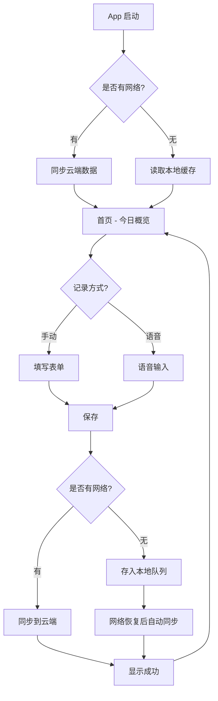
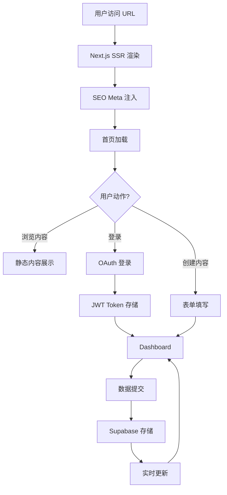
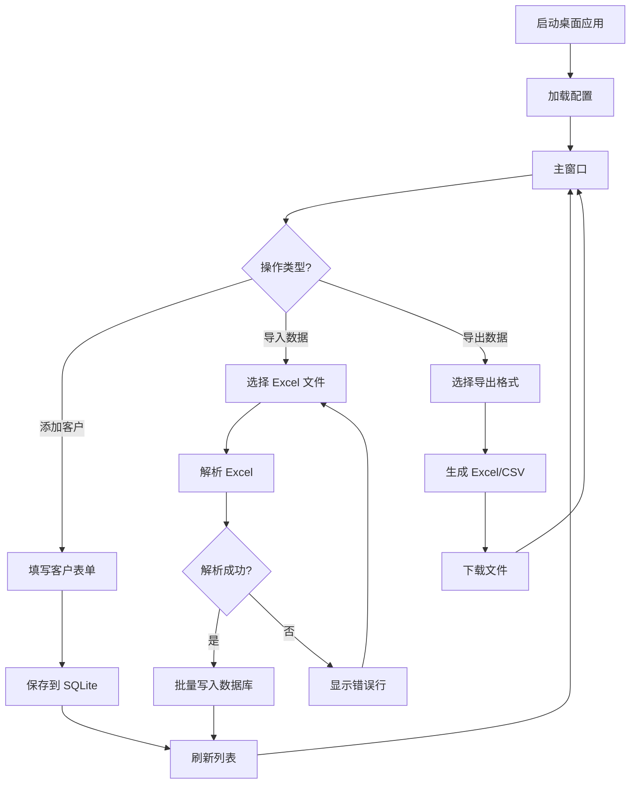
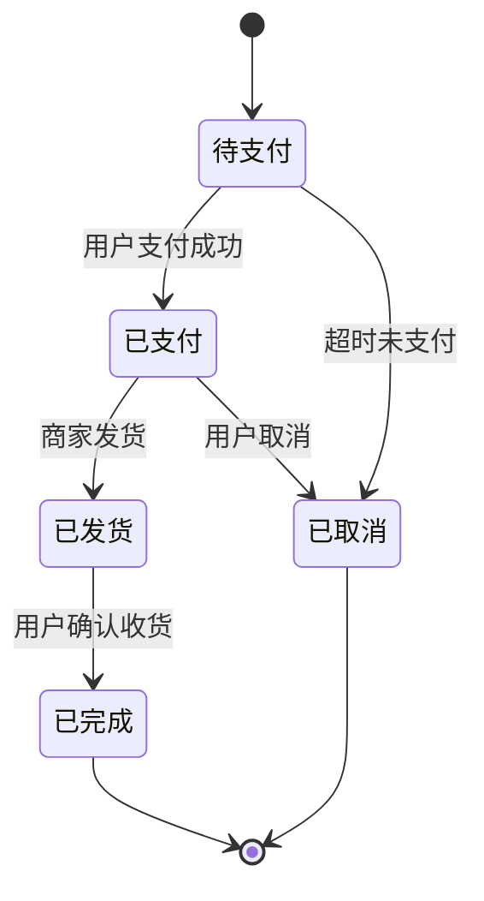
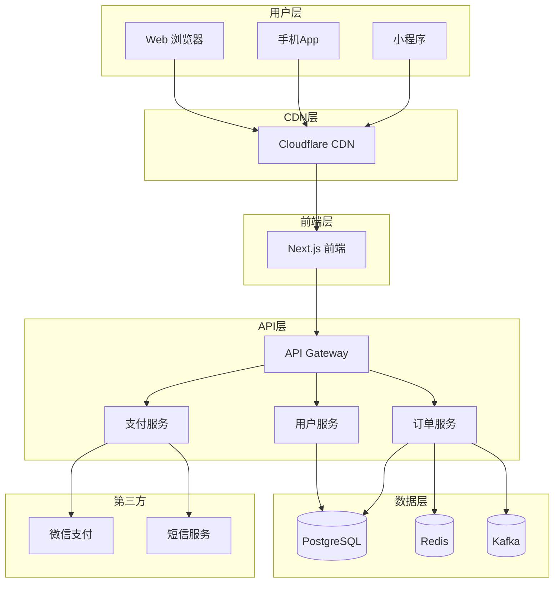

# 流程图生成规范

> 用途：阶段 3 方案书中的可视化流程规范
> 核心理念：Mermaid 代码块即图，Markdown 原生渲染，不追求 HTML/导出

---

## 一、流程图类型与用途

方案书中应包含以下流程图，按需选择：

| # | 流程图类型 | 用途 | 推荐项目类型 |
|---|-----------|------|-------------|
| 1 | **业务流程图** | 用户核心操作流程 | 所有类型 |
| 2 | **功能模块图** | 系统组成结构 | 类型2/C |
| 3 | **时序图** | 关键接口的调用顺序 | 类型2/C |
| 4 | **状态机图** | 关键实体的状态流转 | 类型2/C |
| 5 | **部署拓扑图** | 服务部署结构 | 类型3 |
| 6 | **数据流图** | 数据在各组件间的流向 | 类型3 |

**类型1（快速工具）**：只需业务流程图（1张图）
**类型2（MVP）**：需业务流程图 + 功能模块图 + 状态机图
**类型3（正式项目）**：6类全部
**类型4（Skill）**：业务流程图（Skill使用流程）

---

## 二、生成方式

流程图用 **Mermaid 代码块**（`` ```mermaid ``）写在方案书中，Markdown 渲染器会自动显示为可视化图表。

**不需要**生成 HTML 文件或 PNG 图片——Mermaid 代码本身就是可版本化、可编辑、可渲染的图表。

---

## 三、平台特定流程图模板

### 3.1 小程序流程图（记账小程序示例）

```mermaid
flowchart TD
    A[用户打开小程序] --> B{登录状态?}
    B -->|未登录| C[授权登录]
    C --> D[首页]
    B -->|已登录| D
    D --> E[点击"记账"]
    E --> F[选择拍照/相册]
    F --> G[拍摄小票/选择图片]
    G --> H[OCR 识别小票]
    H --> I{识别成功?}
    I -->|否| J[手动输入金额/分类]
    J --> K[确认记录]
    I -->|是| L[显示识别结果]
    L --> M{用户确认/修改?}
    M -->|确认| K
    M -->|修改| J
    K --> N[记录存入云端]
    N --> O[显示记账成功]
    O --> D
```

### 3.2 App 流程图（健康监测App示例）



### 3.3 Web 流程图（SEO友好型网页示例）



### 3.4 桌面流程图（客户管理工具示例）



### 3.5 Skill 流程图（周报生成Skill示例）

```mermaid
flowchart TD
    A[用户触发Skill] --> B[读取项目文件]
    B --> C[分析代码变更]
    C --> D{有变更?}
    D -->|否| E[提示"无新增变更"]
    D -->|是| F[提取提交信息]
    F --> G[生成周报Markdown]
    G --> H[保存到指定目录]
    H --> I[提示"周报已生成"]
    E --> A
    I --> A
```

### 3.6 状态机图示例（订单状态流转）



### 3.7 部署拓扑图示例



---

## 四、流程图设计原则

1. **可读性优先**：节点文字 ≤ 15 字，避免过于密集
2. **分层展示**：复杂流程用子图（subgraph）分组
3. **方向统一**：从上到下，或从左到右，不要混用
4. **标注关键路径**：用虚线或高亮标注关键节点

---

## 五、与开发流程的衔接

流程图生成后，开发者按以下顺序使用：

```
1. 先看业务流程图   → 理解用户操作流程
2. 再看功能模块图   → 拆分功能模块
3. 接着看时序图     → 明确接口调用
4. 最后看状态机图   → 理解状态流转
```

**流程图即开发圣经**，代码实现必须与流程图一致，如有变更需同步更新流程图。
