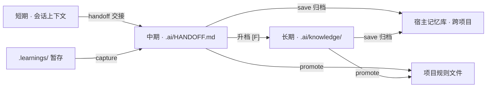

<div align="center">

# super-memory

**AI 的记忆与知识管理工作台**

把开发中的错误、纠正、进度与偏好，沉淀成结构化、可检索、可交接的项目记忆。
纯 Markdown 文件驱动——无外部服务、无向量库，检索靠 grep + frontmatter + 索引。

[](https://github.com/harryopo/super-memory/actions/workflows/ci.yml)
[](LICENSE)


**[在线介绍页](https://harryopo.github.io/super-memory/)** · [快速安装](#-安装) · [六个子命令](#-六个子命令)

</div>

---

## ✨ 它解决什么

AI 会话结束即失忆；交接靠口口相传，散落的记忆文档越积越乱、越读越偏。
super-memory 用一套**结构化的记忆生命周期**回答三个问题：

- **存**——错误、纠正、进度、偏好，各归其位，置信度可判（`[V][W][Q][R][F]`）
- **交**——会话交接写满写实，进度三问（到哪了 / 停在哪 / 下一步）不看全文即可回答
- **读**——接手时探测散落记忆文档、按角色读、对代码真值核验，产出接手简报

## 🗂 三层记忆模型



*每条知识有唯一的家，其他位置只放索引。*

## 🧩 六个子命令

| 子命令 | 什么时候走 |
|---|---|
| **capture** | 错误 / 用户纠正 / 知识过时 / 更好做法 → 写 `.learnings/` |
| **handoff** | 会话结束或断点暂停：写 `.ai/HANDOFF.md` 交接，已验证通用内容升档长期库 |
| **intake** | 接手项目 / 继续上次会话 / 新会话开工：探测记忆文档 → 真值核验 → 接手简报；新项目初始化骨架 |
| **save** | 会话结束：跨会话偏好与事实归档 agent 记忆库并更新索引 |
| **neat** | 里程碑：尺寸体检 → 盘点 → 变更矩阵 → 删除审查 → 修改 → 自检 → 摘要 |
| **promote** | 反复出现的学习提炼成规则，写进项目规则文件 |

## ⚙️ 核心机制

| 机制 | 一句话 | 借鉴 |
|---|---|---|
| 巩固四操作 | 写入前 grep 相似旧条目，ADD / UPDATE / SUPERSEDE / NOOP 四选一并写明判定；删除一律降级留痕 | mem0 |
| Related 互链 | 知识条目双向链接，入库前检索相关旧条目 | A-Mem |
| 双时间戳 | `生效` / `记录` 分离，过时可判、演化可追 | Graphiti |
| 记忆体检 | 断链 / 重复 / 非法置信度码 / 超龄未验证，四项机械检查 | Letta /doctor |
| 探测式寻址 | 不硬编码宿主路径：宿主自述 → 规则文件 → glob 探测 → 兜底；8 类宿主形态实测 | — |
| 同义标签 + 排序检索 | 条目写 `Tags`（中文词+英文词+领域词），多词查询走 `scripts/search.py`（BM25-lite，零依赖） | IR 常识 |
| intake 接手 | 探测散落记忆（中文名 / 日期变体 / 多容器）→ 真值核验 → 接手简报 | — |

## 📦 安装

```bash
mkdir -p ~/.agents/skills/super-memory
curl -L https://github.com/harryopo/super-memory/archive/refs/heads/main.tar.gz \
  | tar -xz -C ~/.agents/skills/super-memory --strip-components=1
```

安装位按宿主而定：`~/.agents/skills/`、`~/.zcode/skills/`、`~/.claude/skills/` 或项目 `.agents/skills/`。
装完跑 `python scripts/verify.py` 应全绿。

## 💬 触发

装好后说自然语言即可：

> 「保存记忆」 · 「接手这个项目」 · 「继续上次到哪了」 · 「整理一下文档和记忆」 · 「新项目初始化」 · 「这条记进 memory」

<details>
<summary>完整触发词与反例（点开）</summary>

触发词见 [SKILL.md](SKILL.md) 的 description：保存记忆、save memory、会话结束、先这样、就这些、同步一下、
整理文档、整理记忆、更新记忆、梳理一下、neat、sync up、tidy up docs、收尾、这个阶段做完了、
新人能直接上手、沉淀经验、记录下来、推广到规则、以后都要这样、这条记进 memory、接手这个项目、
接手已有项目、继续上次到哪了、交接、HANDOFF、断点在哪、新项目初始化。

**不触发**：「整理一下这段代码」（对象是代码）、「收尾这个需求，先写测试」（收尾指开发流程）、
「帮我总结这个网页」（内容摘要）、「更新一下依赖」（对象是包）。

</details>

## 🤝 与其他机制共存

- **宿主自动记忆**（Claude Code memory tool 等）：写前先 grep 索引，命中同主题就 Edit 不新建（`ADD/UPDATE/SUPERSEDE/NOOP` 四操作，见 `references/knowledge-tiers.md`）
- **self-improving-agent**：`.learnings/` 格式权威归本 skill 的 capture；写入前 grep 去重，同一事件不记两遍
- **claude-mem 等自动记忆插件**：可共存，但插件不得写 `.ai/` 与 `.learnings/`（这两处格式与历史由本 skill 排他管理）
- **hooks 自动触发**（可选增强）：四个时机——开场注入 §0 快照、**命令失败提醒 capture**、压缩前抢救、结束提醒归档——配置见 `references/hooks-setup.md`，不装也能用
- **记忆目录 git 化 / 语义检索**（可选增强，opt-in）：编辑历史与回滚、真·语义召回——方案见 `references/memory-git.md` 与 `references/semantic-search.md`

## 🧪 质量

- `evals/evals.json`：**18 条评测用例全部真实执行**（沙箱 fixture 逐例核对 expect / fail）
- `scripts/verify.py` + CI：结构自检（体积上限 / 断链 / 黄金样本断言 / 规范字段）每次推送运行
- 规则全部来自**真实项目 dogfood**：探测清单的命名与容器变体来自 40 个真实项目实测；
  追加式文件读取、mtime 新鲜度三角等规则各自对应一次被用户纠正的真实事故，可溯源

## License

[MIT](LICENSE)
